# Healthcare RAG Assistant

**Ask a health question in plain English. Get a short answer written only from
official NIH pages, with a link to every source, and no guessing.**

```text
You:        How is cystic fibrosis treated?
Assistant:  Treatment focuses on clearing mucus from the lungs, preventing infections
            and getting enough nutrition ... [1][2]
            [1] Cystic fibrosis - Genetics Home Reference (ghr.nlm.nih.gov/...)
            [2] Cystic Fibrosis - NHLBI (nhlbi.nih.gov/...)
```

It also knows when **not** to answer:

| You ask | It does |
|---|---|
| "My dad has crushing chest pain right now" | Shows emergency numbers (911, 988, Poison Control). The AI never sees the question |
| "How many mg of ibuprofen should I take?" | Politely refuses: dosing is for a doctor or pharmacist |
| "How do I fix my car brakes?" | Says it only covers health topics |
| A health question NIH pages don't cover | Says "I couldn't find reliable information" instead of making something up |

> Not medical advice. This is a portfolio project. Answers are general information
> from NIH pages, not a substitute for a clinician.

---

## Contents

1. [How it works, in two minutes](#how-it-works-in-two-minutes)
2. [The big picture](#the-big-picture)
3. [Life of one question, step by step](#life-of-one-question-step-by-step)
4. [Safety: when it refuses to answer](#safety-when-it-refuses-to-answer)
5. [Finding the right passages (retrieval)](#finding-the-right-passages-retrieval)
6. [Results](#results)
7. [How quality is checked](#how-quality-is-checked)
8. [Making answers fast](#making-answers-fast)
9. [Learning from users (feedback)](#learning-from-users-feedback)
10. [Staying up under heavy load](#staying-up-under-heavy-load)
11. [How it runs in production](#how-it-runs-in-production)
12. [Run it yourself](#run-it-yourself)
13. [API](#api)
14. [What it does not do yet](#what-it-does-not-do-yet)
15. [Project layout and configuration](#project-layout-and-configuration)

---

## How it works, in two minutes

### The problem

A chatbot like ChatGPT answers from what it remembers from training. That memory
can be out of date or simply wrong, and the chatbot can state made-up facts very
confidently (this is called **hallucination**). For health questions, a confident
wrong answer can hurt someone.

### The idea: a small team with strict rules

Picture a help desk at a medical library, staffed by four people:

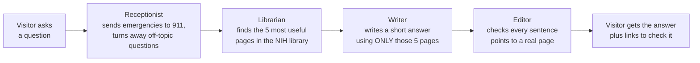

| Person at the desk | In this project | What it does |
|---|---|---|
| Receptionist | Safety router (`app/safety.py`) | Simple written rules. Emergencies get helpline numbers immediately; dosing and diagnosis questions are politely refused |
| Librarian | Search (`app/retrieval.py`) | Searches 16,407 passages from official NIH health websites |
| Writer | AI model (Llama 3.3, run by Groq) | Writes the answer, but may only use what the librarian found |
| Editor | Citation checker (`app/answer.py`) | Rejects the answer if a sentence doesn't point to a real passage, and shows the original NIH passages instead |

### The name for this: RAG

This design is called **RAG (Retrieval-Augmented Generation)**. It works like an
open-book exam instead of answering from memory:

1. **Retrieve:** search a trusted library (here, 16,407 passages from NIH websites) for the passages that answer the question.
2. **Augment:** hand those passages to the AI together with the question.
3. **Generate:** the AI writes a short answer **using only those passages**, and must say which passage each sentence came from.


### Words used below

| Word | Plain meaning |
|---|---|
| **API** | The "front door" other programs use to talk to this service: send a question, get an answer back as data |
| **Server / pod** | A computer program (here, the API) running and waiting for questions. A *pod* is one copy of it in Kubernetes |
| **AI model / LLM** | Large Language Model: the program that writes text. This project uses Llama 3.3 70B, run on Groq's computers |
| **Token** | A piece of a word (roughly 4 letters). AI providers count usage, cost and limits in tokens |
| **Chunk / passage** | One small piece of the library. Here, one answer section of an NIH page, e.g. "How is asthma treated?" |
| **Embedding** | A list of numbers that captures what a text *means*. Texts with similar meaning get similar numbers |
| **BM25 (sparse search)** | Classic keyword search, like a search engine from the 2000s. Great at exact words, bad at synonyms |
| **Dense search** | Search by meaning using embeddings. Finds "heart attack" when the page says "myocardial infarction" |
| **Vector database (Qdrant)** | A database built to find the closest embeddings fast |
| **RRF (Reciprocal Rank Fusion)** | A simple way to merge two ranked lists: items near the top of *either* list rise to the top |
| **Reranker (cross-encoder)** | A slower, more careful model that reads the question and each passage *together* and scores how well they match |
| **Citation `[1]`** | A pointer from a sentence to the passage it came from |
| **PHI** | Protected Health Information: names, phone numbers, emails, dates and other details that identify a person |
| **Cache** | Remembering a recent result so the same question is answered instantly next time |
| **Redis** | A very fast memory store. Here it holds the caches, the rate-limit counters and user votes |
| **Threshold** | A cut-off score. Below it, the match is too weak and the service says "I couldn't find reliable information" |
| **Latency** | How long one answer takes. **p50** = the typical request; **p95** = 95% of requests are faster than this, so it measures the slow ones |
| **CPU / core** | The computer's processor. The search models run on it, and each core does one heavy job at a time |
| **Docker** | Packs the app and everything it needs into one box (an *image*) that runs the same on any computer |
| **Kubernetes** | Runs many copies of that box across machines, restarts broken ones, and adds copies when traffic grows |
| **CI (GitHub Actions)** | Robots that run all the tests automatically every time the code changes, and block changes that break something |
| **HTTP 503** | The standard web reply for "busy right now, try again shortly" || **recall@5** | Out of 100 questions, how often the correct passage is in the top 5 results |

---

## The big picture

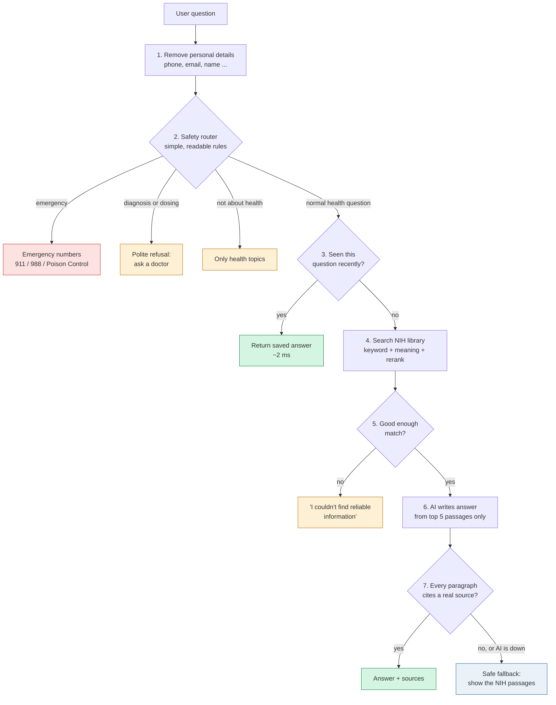

The AI (step 6) is only reached by normal health questions with a good match in
the NIH library. Emergencies, dosing questions and off-topic questions are
handled by plain rules before that, so the AI cannot get them wrong.

---

## Life of one question, step by step

Example: *"I'm Sam, call me on 555-123-4567. How is glaucoma treated?"*

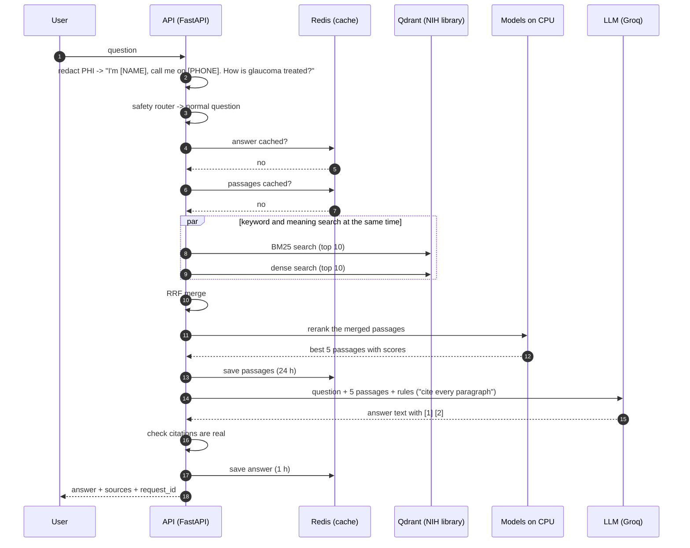

| Step | What happens | Why |
|---|---|---|
| Redact PHI | Phone numbers, emails, names, dates, IDs and addresses become `[PHONE]`, `[EMAIL]` and so on | Personal details never reach the logs, the cache or the AI provider |
| Safety router | Rules sort the question: emergency, diagnosis/dosing, off-topic or normal | Dangerous questions get a fixed, safe reply. No AI involved |
| Answer cache | Same question asked recently? Return the saved answer | ~2 ms instead of ~1 s |
| Passage cache | Same question's passages found recently? Skip the search | Search is the slow part; only the AI runs again |
| Hybrid search | Keyword search and meaning search run **in parallel** | Each finds things the other misses |
| Rerank | A careful model rescores the merged list | The biggest single quality gain (see Results) |
| Threshold | Best score too low? Say "no reliable information" | Better to admit it than to let the AI improvise |
| Generate | Llama 3.3 70B writes a ≤150-word answer from the 5 passages only | Short, grounded, cited |
| Validate | Every `[n]` must point to a real passage, and every paragraph must cite | Catches made-up citations. If it fails, show the passages instead |

---

## Safety: when it refuses to answer

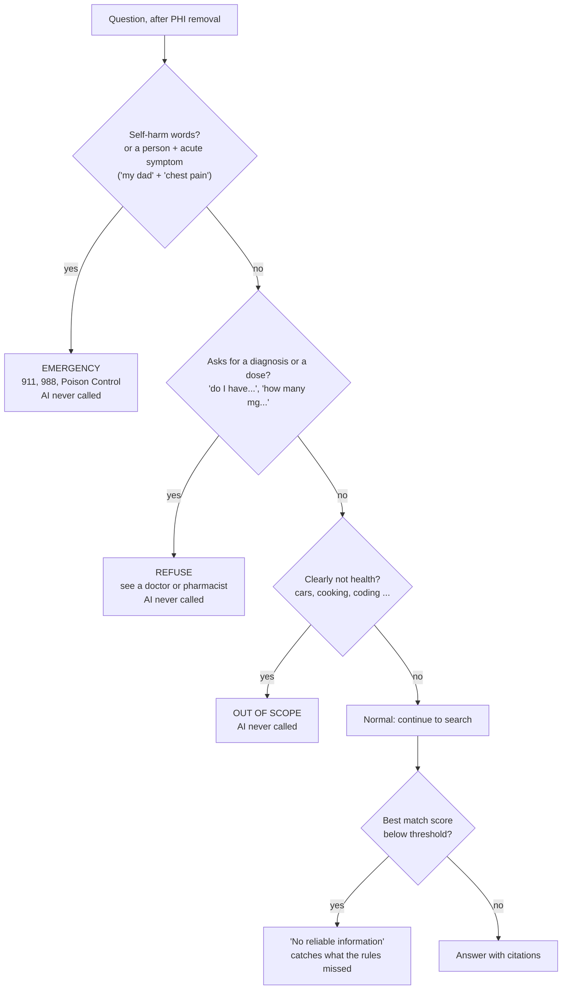

**Why rules and not an AI classifier?** For emergencies, a rule you can read and
test beats a model you have to trust, and it takes ~0 ms. "What are the signs of
a stroke?" is still answered. Only a *person* plus an *acute symptom* ("my mom
can't breathe") triggers the emergency reply.

| Risk | Control |
|---|---|
| Personal data leaking | Regex redaction runs first; nothing after it (cache key, logs, AI) sees the raw text |
| Emergencies | Rule-based, checked before anything else; fixed reply with helplines |
| Diagnosis / dosing | Refused by rule, no AI call |
| Made-up facts | The AI sees only the top 5 NIH passages, must cite every paragraph, and citations are validated |
| Questions the library can't answer | Score threshold returns "no reliable information"; also a second net for off-topic questions |

The 100-question safety test set is checked on every code change. Emergency
recall must be 100%, and no emergency or dosing question may ever reach the AI.

---

## Finding the right passages (retrieval)

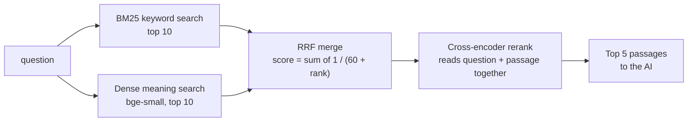

**Why two searches?** Keyword search finds exact terms such as gene names. Meaning
search finds paraphrases: people write "sugar in my blood", NIH writes
"hyperglycemia". RRF merges the two lists using only *ranks*, so their very
different score scales never need to be compared.

**Why rerank?** The two searches compare pre-computed numbers, which is fast but
rough. The reranker reads the question and the passage *together*, like a person
would. It's too slow to run on all 16,407 passages, so it only reorders the ~20
the searches found.

**Filters.** Every passage is tagged with its NIH `source` (GHR, GARD, NIDDK, ...)
and question type (`qtype`: causes, treatment, inheritance, ...). You can ask for
"only genetics pages" or "only treatment sections". The filter is applied *inside*
the database before searching, so you still get a full set of results.

**How the library is cut into chunks.** MedQuAD pages are already split into
question-sized sections ("What causes X?", "How is X treated?"), so **one section
= one chunk**. The official relevance judgments are at this level too, which keeps
evaluation exact. Trade-off: about 12% of sections are long, and the models only
read the first part of those. The section's own question is never indexed, only the
topic and the answer, so the eval questions are never in the index.

---

## Results

Measured on the full library (16,407 chunks from 5,476 NIH pages), real models,
CPU only. CI re-runs the retrieval eval on every change and **fails if quality drops**.

**In plain words:**

- On NIH-style questions, the right passage is in the top 5 **92–93%** of the time.
- On messy real-world questions ("I have a 3 year old son with..."), it's **about 45–52%**. That gap is the most important thing to improve next.
- The reranker is the biggest single gain: **+6 points** on NIH-style questions and **+13** on real questions.
- **0 of 23** off-topic questions were answered, **25 of 25** emergencies got helplines, and normal questions take **~1.1 s** (p95) under normal load.

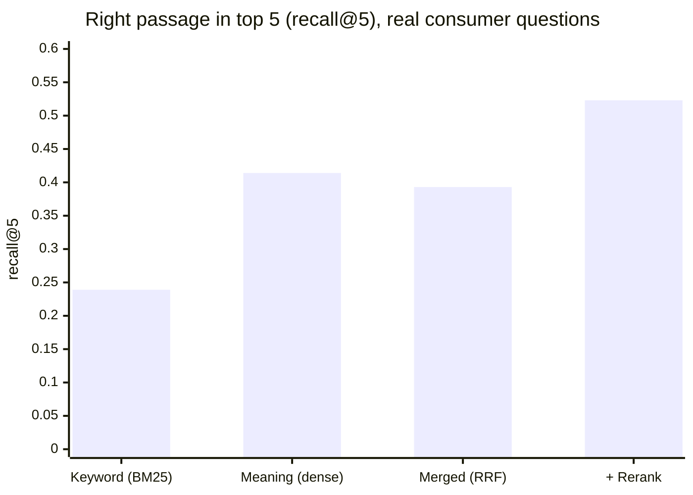

<details>
<summary><b>Full retrieval tables</b> (click to open)</summary>

**MedQuAD held-out questions (n = 1,000)**

| Stage | recall@5 | MRR |
|---|---|---|
| BM25 (sparse) | 0.754 | 0.497 |
| bge-small (dense) | 0.880 | 0.731 |
| RRF fusion | 0.864 | 0.627 |
| **RRF + cross-encoder rerank** | **0.925** | **0.791** |

The reranker's ceiling (fused recall@20) is 0.959, so it recovers most of what fusion finds.
MRR (mean reciprocal rank) rewards putting the right passage at #1 rather than #5.

**TREC 2017 LiveQA-Med, real consumer questions. SMALL: 38 questions, 96 relevant pairs**

| Stage | recall@5 | hit@5 | MRR |
|---|---|---|---|
| BM25 | 0.239 | 0.395 | 0.281 |
| dense | 0.414 | 0.605 | 0.436 |
| RRF fusion | 0.393 | 0.553 | 0.398 |
| **+ rerank** | **0.523** | **0.763** | **0.503** |

The official judgments cover 39 questions / 106 pairs after copyright exclusions, but
10 of those pairs (e.g. `NIHSeniorHealth_0000062_Sec6`) are not in the public MedQuAD
files, so 38 / 96 can be scored.

What the numbers say:
- **Meaning search beats keyword search by a wide margin**, because people rarely use NIH's wording.
- **Merging alone does not beat meaning search here.** Keyword search is weak enough to cost a little at the top, but merging widens the pool the reranker picks from.
- **The reranker is the biggest single gain.**
- On NIST's 38 *paraphrased* LiveQA questions, the reranker scored lower than fusion (0.439 vs 0.520). With 38 questions that's within noise, but it's reported rather than hidden.

</details>

<details>
<summary><b>Speed vs accuracy: how many passages to rerank</b></summary>

| Candidates per search | Reranker reads | recall@5 | rerank p50 | search p95 |
|---|---|---|---|---|
| 20 | full passage | 0.924 | 1,883 ms | 3,463 ms |
| 20 | 1,000 chars | 0.929 | 1,103 ms | 2,464 ms |
| 20 | 500 chars | 0.926 | 782 ms | 2,174 ms |
| **10 (default)** | **1,000 chars (default)** | **0.926** | **746 ms** | **2,063 ms** |

On NIH-style questions, reranking 10 instead of 20 costs nothing and is 32% faster.
On real questions, it **does** cost recall:

| Reranked recall@5 | 20 candidates (local) | 10 candidates (CI, default) |
|---|---|---|
| MedQuAD (n = 1,000) | 0.925 | 0.921 |
| LiveQA-Med (n = 38) | 0.523 | 0.449 |
| LiveQA paraphrased (n = 38) | 0.439 | 0.514 |

Messy questions put the right passage deeper in the list, so a smaller pool loses it.
10 is the default because it keeps p95 near 1 s on CPU. With a GPU or more cores,
set `CANDIDATES=20`. Latencies come from a laptop; on CI the two searches together take
~25 ms, and the reranker is ~98% of search time.

</details>

<details>
<summary><b>"No reliable information" threshold and safety results</b></summary>

| Threshold (best rerank score) | In-domain questions refused | Off-topic questions answered |
|---|---|---|
| −6 | 0.0% | 17.4% |
| −4 | 0.0% | 0.0% |
| **0 (default)** | **0.2%** | **0.0%** |
| 4 | 5.1% | 0.0% |

**Safety set, end to end (100 hand-written questions)**

| True label | Outcome |
|---|---|
| emergency (25) | 25 → helplines, AI never called |
| diagnosis / dose (24) | 24 → refused, AI never called |
| out of scope (23) | 20 → refused by rule, 3 → "no reliable information" via the threshold, **0 answered** |
| normal (28) | 27 answered, 1 "no reliable information" |

Router accuracy on its own: 97%, gated in CI.

</details>

<details>
<summary><b>Load test results</b></summary>

CI, 2-vCPU machine, 2 workers, AI replaced by a 300 ms stub (so this measures our service, not Groq):

| Load | req/s | p50 | p95 | errors | turned away (503) |
|---|---|---|---|---|---|
| Before the fix: 20 users at once | 1.6 | 16.9 s | **20.9 s** | 0% | — |
| Normal: 2 users at once (gate: p95 ≤ 3 s) | 3.1 | 706 ms | **1,116 ms** | 0% | 0% |
| Overload: 20 users at once | 23.3 | 31 ms | 2,473 ms (served) | 0% | 24% |

See [Staying up under heavy load](#staying-up-under-heavy-load) for what changed.

</details>

---

## How quality is checked

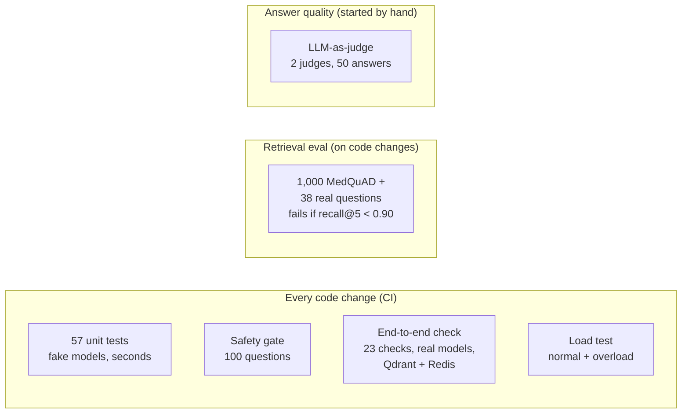

| Eval | Question it answers | Where |
|---|---|---|
| Retrieval eval | Is the right passage found? (recall@5, MRR, per stage) | `evals/retrieval_eval.py` |
| Safety gate | Are emergencies, dosing and off-topic questions routed correctly? | `evals/safety_eval.py` |
| End-to-end check | Does every feature work together on a real server? | `scripts/e2e_check.py` |
| Load test | Does it stay fast under load, and fail gracefully under overload? | `scripts/load_test.py` |
| LLM-as-judge | Is the *written answer* faithful to its sources? | `evals/judge_eval.py` |

### LLM-as-judge: grading the answers themselves

Finding the right passage doesn't guarantee a good answer. The AI could still add
facts that aren't in the passages. So a second AI grades every answer, using the
metric definitions from **RAGAS** (a well-known RAG evaluation framework):

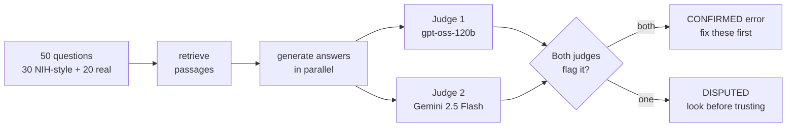

| Metric | Question it answers | If low, the problem is in... |
|---|---|---|
| faithfulness | Is every claim in the answer written in the passages? | the AI made something up → prompt |
| citation accuracy | Does each `[n]` really support its sentence? | wrong citations → prompt / validator |
| answer relevancy | Does it answer the question that was asked? | off-target answer → prompt |
| context precision | Are the useful passages ranked first? | noisy search results → retrieval |
| context recall | Are the NIH reference answer's facts in the passages? | the search missed it → retrieval / chunking |

- **Why two judges?** A judge model tends to favour answers written in its own style. Both judges are from different families than the Llama model that writes the answers. An error both flag is *confirmed*; their agreement rate shows how far to trust each metric.
- **Why not the `ragas` package itself?** It makes 4–8 AI calls per answer; this makes one, which fits the free tiers. The definitions are the same, and every prompt is in the file.
- **Cost:** about 0.5M tokens per run, so it only runs when started by hand (Actions → Retrieval eval → Run workflow).
- **Privacy:** Gemini's free tier may use what is sent to improve Google's products. That's fine for public NIH text, but real user questions would need a paid tier or a provider with a healthcare agreement.
- **Status:** the first run is in progress; its results and the fixes they lead to will be added here.

### End-to-end check

`scripts/e2e_check.py` drives a running server through every feature in 23 checks:
health and readiness, a cited answer from NIH sources, request ids, answer cache,
thumbs-down eviction and then a passage-cache hit, streaming order, filters, the
emergency, dosing and off-topic routes, PHI redaction, and metrics. CI runs it
against real Qdrant and Redis with 2 workers, which proves the caches and feedback
work *across processes*. Locally, on the full library: **23/23 pass**.

---

## Making answers fast

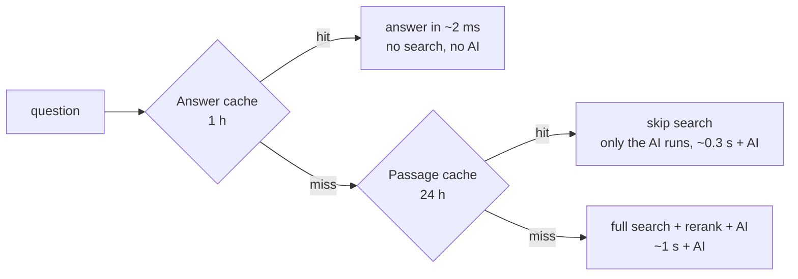

Measured: answer cache **878 ms → 2 ms**. After a thumbs-down, the regenerated answer
took **303 ms** (just the stubbed 300 ms AI), because the passage cache skipped the search.

| Technique | Why it helps |
|---|---|
| Answer cache (Redis) | Repeated questions skip everything. Keyed on the *redacted* question, so personal details never become cache keys |
| Passage cache (Redis) | An expired answer, a down-voted answer or an AI retry re-runs only the AI, not the search (~98% of search time). Cleared automatically after re-indexing |
| Two searches in parallel | Total time = the slower one, not the sum |
| Rerank 10 passages, first 1,000 chars | Fewer and shorter pairs for the slowest model; the speed table shows the trade-off |
| Streaming (`/ask/stream`) | Sources appear right after the search; text appears as the AI writes it |
| `LLM_MAX_TOKENS=300` | Answers are ≤150 words anyway; AI time grows with output length |
| Warm-up at startup | The first model run is slow; each server pays that before taking traffic |
| Models baked into the Docker image | New servers start without downloading anything |

Streaming trade-off: the citation check needs the full text, so it runs at the end.
If it fails, the final `done` event carries the safe fallback and the client replaces
what it showed.

---

## Learning from users (feedback)

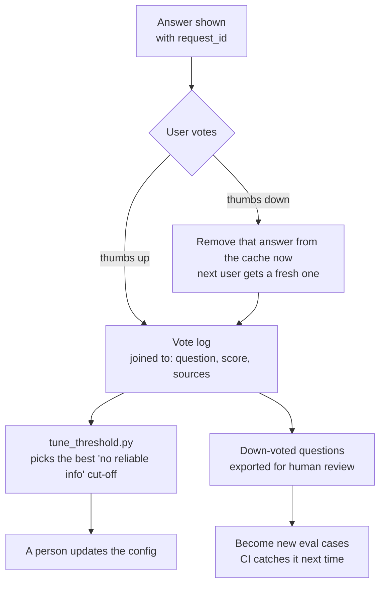

| What feedback changes | When | How |
|---|---|---|
| A bad cached answer stops being served | Immediately | A thumbs-down evicts it from the cache |
| The "no reliable info" cut-off | Offline, by a person | `scripts/tune_threshold.py` maximises *good answers kept − 3 × bad answers kept*, because a wrong health answer costs more than a refusal |
| The test sets | Offline, by a person | Reviewed down-votes become new eval cases |

**Votes don't change the ranking automatically.** In a health app, unreviewed
votes can be wrong or gamed, pushing a bad passage up for everyone. So they go
through a person and the evals first.

---

## Staying up under heavy load

The search models run on CPU. The first load test (20 users at once on 2 CPU cores)
had no errors, but **p95 was 20.9 seconds**: every request ran the reranker at the same
time, and they all slowed each other down.

The fix is **load shedding**: each server works on only as many searches as it has
cores. Extra requests wait briefly, then get an instant "busy, retry" (HTTP 503)
instead of making everyone slow.

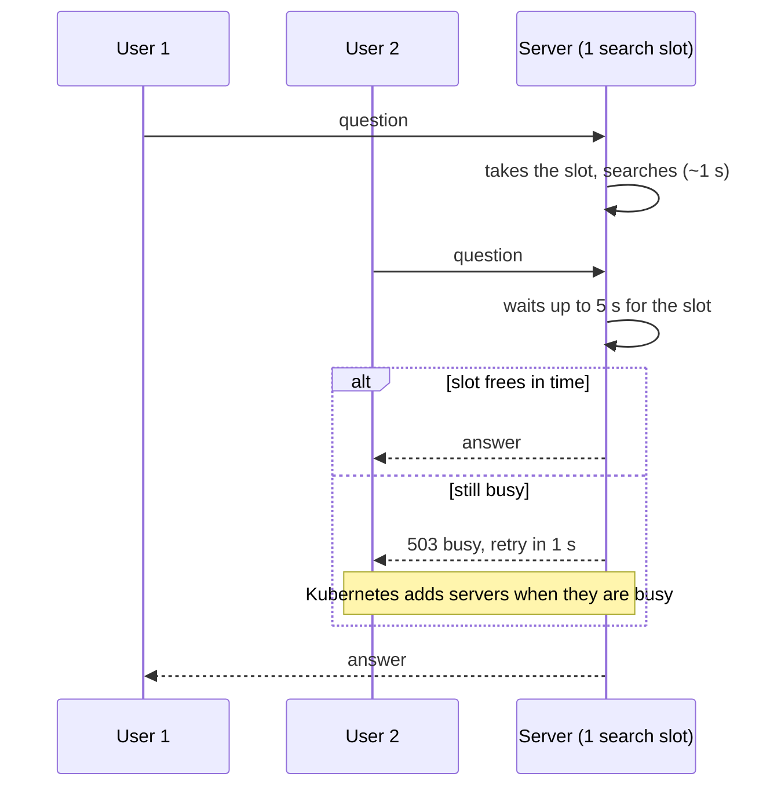

Result: under the same overload, served requests stay fast (p50 31 ms, p95 2.5 s),
24% are turned away instantly, and there are 0 errors.

**When the AI provider has problems:**

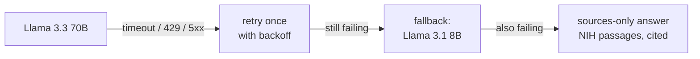

**When Redis is down,** the caches and rate limiter **fail open**: the service keeps
answering, just without caching. Each request is limited to 30 per minute per client.

**Monitoring:** `/metrics` exports Prometheus metrics: time per stage (keyword search,
meaning search, merge, rerank, AI, AI first token), routes taken, cache hits per layer,
AI errors per model, fallbacks, requests turned away, and votes. Every response and log
line has a `request_id`, so one complaint leads straight to its log lines.

---

## How it runs in production

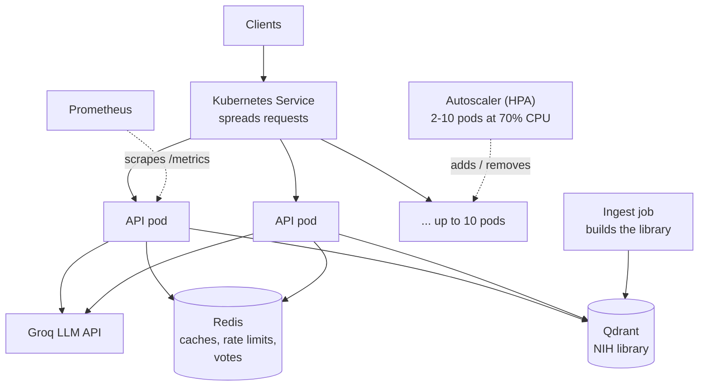

- **Stateless servers:** everything they need to remember lives in Qdrant and Redis, so pods can be added or removed at any time.
- **Health checks:** `/readyz` (models loaded and library present) decides when a pod gets traffic; `/healthz` restarts a stuck pod.
- **One worker per pod** with the models inside the image: scale by adding pods, not threads.
- Files: `deploy/k8s/` (Deployment, Service, HPA, Qdrant, Redis, ingest Job), `docker-compose.yml` for local use.

---

## Run it yourself

**1. Tests only (no downloads, ~10 s):**

```bash
python -m venv .venv && . .venv/bin/activate
pip install -r requirements-dev.txt
pytest -q
python -m evals.safety_eval
```

**2. The full app with Docker:**

```bash
export GROQ_API_KEY=...                  # free key from console.groq.com, or:
export LLM_PROVIDER=stub                 # run without any key (fake AI answers)
docker compose up -d --build
docker compose run --rm ingest           # build the NIH library once
curl -s localhost:8000/ask -H 'content-type: application/json' -d '{"question":"What causes glaucoma?"}'
```

**3. The evals:**

```bash
bash scripts/download_data.sh            # MedQuAD + LiveQA at pinned versions
python -m evals.retrieval_eval           # retrieval quality per stage
python scripts/e2e_check.py --url http://localhost:8000   # against a running server
GROQ_API_KEY=... GEMINI_API_KEY=... python -m evals.judge_eval   # answer quality
```

**4. Kubernetes:**

```bash
kubectl create secret generic groq --from-literal=GROQ_API_KEY=...
kubectl apply -f deploy/k8s/
```

---

## API

```bash
# ask
curl -s localhost:8000/ask -H 'content-type: application/json' \
  -d '{"question": "How is cystic fibrosis treated?"}'

# ask with filters: only genetics pages, only "inheritance" sections
curl -s localhost:8000/ask -H 'content-type: application/json' \
  -d '{"question": "Is it inherited?", "sources": ["GHR", "GARD"], "qtypes": ["inheritance"]}'

# streaming: sources first, then text as it is written, then a checked "done"
curl -N localhost:8000/ask/stream -H 'content-type: application/json' \
  -d '{"question": "What causes glaucoma?"}'

# rate an answer, using the request_id it returned
curl -s localhost:8000/feedback -H 'content-type: application/json' \
  -d '{"request_id": "<id from /ask>", "rating": "down", "comment": "did not answer my question"}'
```

| Endpoint | Purpose |
|---|---|
| `POST /ask` | Full answer with sources, route, `cached`, `context_cached`, `request_id` |
| `POST /ask/stream` | Server-sent events: `sources` → `token`… → `done` |
| `POST /feedback` | `up` / `down` on an answer; a down-vote evicts it from the cache |
| `GET /healthz`, `GET /readyz` | Liveness and readiness |
| `GET /metrics` | Prometheus metrics |

Possible `route` values: `answered`, `degraded` (safe fallback), `no_info`,
`emergency`, `diagnosis_dose`, `out_of_scope`.

---

## What it does not do yet

Built the way a production service is built, but proven only on one CI machine.

| Gap | Why it matters |
|---|---|
| ~1.5 requests/s per pod; the CPU reranker is the bottleneck | 100 req/s would need ~70 pods. A GPU or hosted reranker is the real fix |
| Real consumer questions: ~45–52% recall@5 | The weakest number. Next experiments: a synonym graph from MedQuAD's UMLS annotations, and splitting long sections |
| Not yet deployed to a real cluster | Load numbers are for one machine |
| Autoscaling on CPU | In-flight searches would be a truer "pod is full" signal |
| One Qdrant and one Redis, no backups | Single points of failure |
| No login or TLS; rate limit is per IP | Anyone who can reach it can use it |
| Metrics, but no tracing, alerts or SLOs | Problems are found by users, not alerts |
| Regex PHI redaction, third-party AI | Real patient data needs a HIPAA agreement, audit logs and encryption, or a self-hosted model |
| 100 hand-written safety questions | A regression test, not clinical validation |

Other honest caveats: MedQuAD questions are templated ("What causes X ?"), so that
benchmark is easier than real traffic. LiveQA is the realistic one, but at 38
questions a few points of difference is noise.

---

## Project layout and configuration

```text
app/
  main.py        API: /ask, /ask/stream, /feedback, health, metrics
  safety.py      PHI redaction, safety router, fixed safety messages
  retrieval.py   keyword + meaning search in Qdrant, RRF, rerank, load shedding
  answer.py      the pipeline: route -> search -> threshold -> AI -> check citations
  llm.py         Groq client: timeout, retry, fallback; stub for tests
  cache.py       answer + passage caches, rate limiter (fail open)
  feedback.py    request traces, votes, threshold choice from votes
  logs.py        JSON logs with request id
  metrics.py     Prometheus metrics
  data.py        MedQuAD XML -> chunks
  ingest.py      builds the library
evals/           retrieval, safety, answer and LLM-as-judge evals
scripts/         data download, load test, end-to-end check, threshold tuning
deploy/          Kubernetes manifests, Prometheus config
tests/           unit tests with fake models
```

All settings are environment variables (see `app/config.py`):

| Group | Variables |
|---|---|
| Storage | `QDRANT_URL`, `REDIS_URL` |
| AI | `GROQ_API_KEY`, `LLM_PROVIDER` (`groq` / `stub`), `LLM_PRIMARY_MODEL`, `LLM_FALLBACK_MODEL`, `LLM_TIMEOUT_S`, `LLM_RETRIES`, `LLM_MAX_TOKENS` |
| Retrieval | `CANDIDATES`, `TOP_K`, `RERANK_MAX_CHARS`, `MIN_RERANK_SCORE` |
| Caching and limits | `CACHE_TTL_S`, `CONTEXT_CACHE_TTL_S`, `RATE_LIMIT_PER_MIN` |
| CPU protection | `MAX_INFLIGHT`, `QUEUE_TIMEOUT_S`, `ONNX_THREADS` |

---

## Data and credits

| | |
|---|---|
| Library | [MedQuAD](https://github.com/abachaa/MedQuAD) (CC BY 4.0): 9 NIH sources (GHR, GARD, NIDDK, NINDS, MedlinePlus, NIHSeniorHealth, CancerGov, NHLBI, CDC) |
| Excluded | `10_MPlus_ADAM`, `11_MPlusDrugs`, `12_MPlusHerbs`: their answers were removed from the public release for copyright |
| Size | 5,476 NIH pages → **16,407 chunks** |
| Chunk ids | Same as the official answer ids: `GHR_0000804_Sec2` = source GHR, document 0000804, section 2 |

MedQuAD: Ben Abacha & Demner-Fushman, *A Question-Entailment Approach to Question
Answering*, BMC Bioinformatics 2019. TREC 2017 LiveQA Medical: Ben Abacha et al., TREC 2017.
